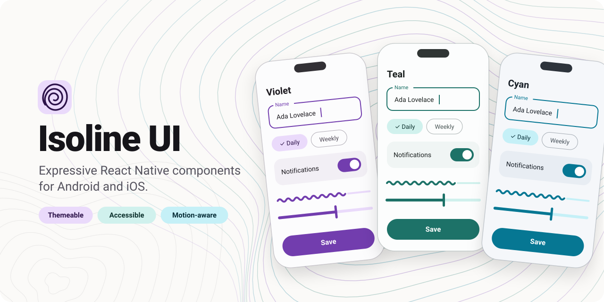

<p align="center">
  <a href="https://isoline-ui.github.io/isoline-ui/">
    <picture>
      <source media="(prefers-color-scheme: dark)" srcset="docs/assets/hero-dark.svg">
      
    </picture>
  </a>
</p>

<p align="center">
  <a href="https://github.com/isoline-ui/isoline-ui/actions/workflows/check.yml"></a>
  <a href="https://isoline-ui.github.io/isoline-ui/"></a>
  
  
  <a href="LICENSE"></a>
</p>

<p align="center">
  <a href="https://isoline-ui.github.io/isoline-ui/"><strong>Documentation</strong></a> ·
  <a href="https://isoline-ui.github.io/isoline-ui/de/docs/">Deutsch</a> ·
  <a href="https://isoline-ui.github.io/isoline-ui/en/docs/getting-started/installation/">Installation</a> ·
  <a href="CHANGELOG.md">Changelog</a> ·
  <a href="CONTRIBUTING.md">Contributing</a>
</p>

## Introduction

Isoline UI is a library of expressive React Native components for Android and iOS.

It keeps shared interaction and accessibility rules in one place, and leaves
colours, typography, labels and haptics to each app. The provider takes an
explicit theme and has no router, store or persistence dependency.

- **Themeable.** Violet, Teal and Cyan light/dark presets, or your own via `extendTheme`.
- **Platform-aware.** Controls follow each OS, with matching geometry, haptics and motion.
- **Accessible.** Shared field labels, hints and errors, roles, focus handling and reduced motion.
- **Expressive motion.** Spring-based sheets, wavy progress, loading shapes and motion tokens built on Reanimated.
- **Native appearance (optional).** Android Material You system colours and iOS Liquid Glass surfaces through [`@isoline-ui/native`](packages/native/README.md).
- **Localizable.** Labels come from your app's translations, and localized amount and date pickers are included.
- **TypeScript.** Generated declarations, with source compiled by your app's Metro and NativeWind setup.

**[Read the full documentation and examples →](https://isoline-ui.github.io/isoline-ui/)**

## Quick start

```tsx
import { useState } from 'react';
import { Button, IsolineProvider, Switch, TextField, themes } from '@isoline-ui/react-native';

export function ProfileForm() {
  const [name, setName] = useState('');
  const [notify, setNotify] = useState(true);

  return (
    <IsolineProvider theme={themes.violet.light} labels={{ close: 'Close' }}>
      <TextField label="Name" value={name} onChangeText={setName} />
      <Switch value={notify} onValueChange={setNotify} accessibilityLabel="Notifications" />
      <Button label="Save" onPress={() => save({ name, notify })} />
    </IsolineProvider>
  );
}
```

Place `IsolineProvider` inside your app's `SafeAreaProvider` and
`GestureHandlerRootView`, and pass the theme that matches the app's light/dark
preference. Labels and haptics come from your app, so its translations and
saved preferences are respected.

To build full screens, see [choosing components](https://isoline-ui.github.io/isoline-ui/en/docs/guides/choosing-components/)
and the [form](https://isoline-ui.github.io/isoline-ui/en/docs/guides/form-screen/),
[list](https://isoline-ui.github.io/isoline-ui/en/docs/guides/data-list-screen/) and
[settings](https://isoline-ui.github.io/isoline-ui/en/docs/guides/settings-screen/) screen guides.

## Components

| Area      | Components                                                                                                 |
| --------- | ---------------------------------------------------------------------------------------------------------- |
| Actions   | Buttons with pending states, button groups, split buttons, icon buttons, floating action buttons and menus |
| Inputs    | Text, password, search and amount fields, checkbox, radio groups, switch, slider, searchable selection     |
| Pickers   | Calendar, date, time and colour pickers                                                                    |
| Selection | Filter and action chips, list selection and section controls                                               |
| Layout    | Cards, list rows, accordions, settings lists and rows, top bars, toolbars, tab bars                        |
| Overlays  | Bottom sheets, panel sheets, dialogs, action menus, popovers, context menus                                |
| Feedback  | Banners, snackbars, undo bars, badges, empty states, skeletons                                             |
| Motion    | Expressive loading indicators, wavy progress, shapes and motion tokens                                     |
| Media     | Avatars, swipeable rows, zoomable images                                                                   |

Try them all in the runnable Expo [showcase](examples/showcase).

## Installation

> [!IMPORTANT]
> **2.0.0 is the development source.** It is not published to npm or attached
> to a GitHub release. The historical alpha.0/alpha.1 releases do not match this
> API. Build local archives from one reviewed commit as shown below.

Requirements: Node.js 24+ and npm. From a checkout of this repository:

```sh
git rev-parse HEAD
npm ci --ignore-scripts
npm run check
npm run pack
```

Record the source commit, then copy `isoline-ui-react-native-2.0.0.tgz` into your
app's `vendor/` directory and install it:

```sh
npm install ./vendor/isoline-ui-react-native-2.0.0.tgz
```

Commit the archive, package manifest and lockfile so CI installs are reproducible.
For native appearance, also install `isoline-ui-native-2.0.0.tgz` from the same commit.

Installing the package does not configure an app on its own. Follow the
[installation guide](https://isoline-ui.github.io/isoline-ui/en/docs/getting-started/installation/)
for peer dependencies, NativeWind, Metro and providers. See
[distribution](docs/distribution.md) for archive and update rules.

## Compatibility

| Runtime             | Targets                                                                                        |
| ------------------- | ---------------------------------------------------------------------------------------------- |
| Expo / React Native | Expo 57 with RN 0.86, Expo 58 with RN 0.88                                                     |
| Platforms           | Android, iOS (web is a preview target for docs)                                                |
| Peers               | React, React Native, Reanimated, Worklets, Gesture Handler, Safe Area Context, SVG, NativeWind |

React and the native runtimes are peer dependencies; do not install a second
copy. See [compatibility](docs/compatibility.md) for what has been verified.

## Development

```sh
npm ci --ignore-scripts
npm run check      # typecheck, tests, build and package checks
npm run showcase   # Expo 58 component showcase
npm run docs:dev   # documentation site
```

Use a development build for native modules. More reading: the
[package guide](packages/react-native/README.md), [design contract](docs/design.md),
[native integration](docs/native.md) and [migration plan](docs/migration.md).

## Contributing

Issues and pull requests are welcome. Read the [contributing guide](CONTRIBUTING.md)
and the [code of conduct](CODE_OF_CONDUCT.md) before you start. Report
vulnerabilities privately as described in the [security policy](SECURITY.md).

Thanks to everyone who has [contributed](https://github.com/isoline-ui/isoline-ui/graphs/contributors).

## Licence

[MIT](LICENSE). Existing source notices are retained; see [NOTICE](NOTICE.md).
